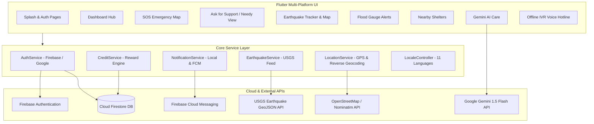
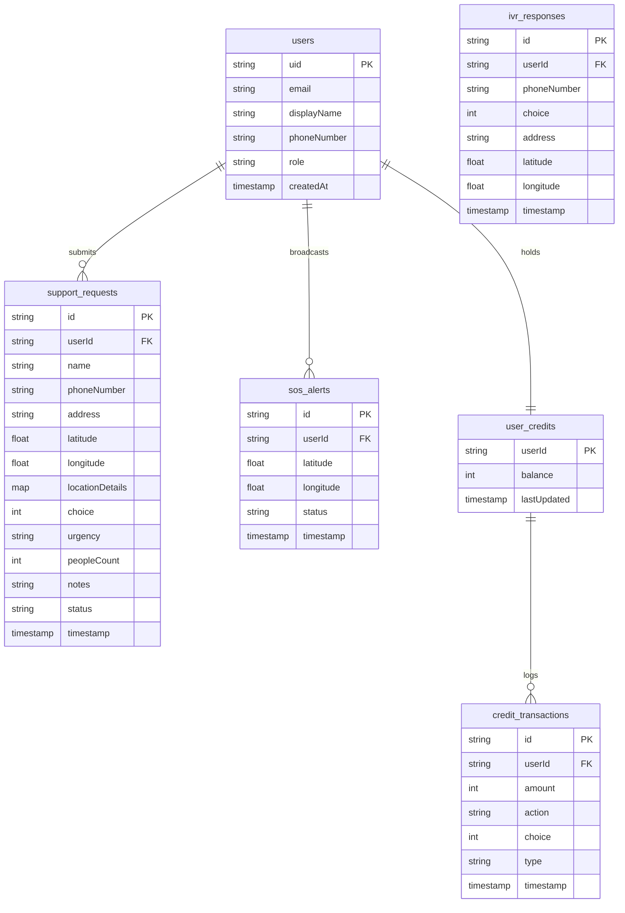

# 🛡️ SAHAAYA (सहायता) — Disaster Management & Relief Platform
### Full Project Technical & Functional Documentation

---

## 📌 1. Project Overview & Mission

**SAHAAYA** is an advanced, production-grade **Disaster Management, Emergency Response, and Community Relief Platform** built using **Flutter**. Designed to protect communities and save lives during catastrophic events (Earthquakes, Floods, Cyclones, Civil Emergencies), Sahaaya bridges the gap between stranded citizens, first responders, nearby shelters, and volunteer organizations.

### Key Highlights:
- **Multi-Hazard Alert System:** Real-time USGS earthquake telemetry and sensor-based flood gauge alerts.
- **Instant SOS Broadcast:** One-tap GPS distress transmission with automated hazard radius mapping.
- **Crowdsourced "Ask for Support":** Direct citizen aid dispatch with automated GPS reverse geocoding into street-level addresses.
- **Offline-First IVR Hotline Simulator:** Simulates automated telephone keypads (1/2/3) for feature-phone users during network breakdown.
- **AI Disaster Assistant:** 24/7 intelligent disaster preparedness & first-aid care powered by **Google Gemini 1.5 Flash**.
- **Safe Havens & Shelter Directory:** Live relief camp locator with distance metrics, occupancy capacity, and medical readiness.
- **Multilingual Support:** Fully localized in **11 Indian and global languages** (English, Hindi, Punjabi, Bengali, Gujarati, Kannada, Malayalam, Marathi, Tamil, Telugu, Spanish).
- **Gamified Community Credits:** Reward system awarding civic credits to citizens and volunteers for crisis response.

---

## 🏗️ 2. Technology Stack & Architecture



### Technology Breakdown:
| Component | Technology | Purpose |
|---|---|---|
| **Framework** | Flutter 3.x (Dart 3.9+) | Cross-platform UI for Android, iOS, and Web |
| **Routing** | GoRouter 16.x | Declarative routing with auth redirection & smooth slide/fade transitions |
| **Authentication** | Firebase Auth + Google Sign-In | Email/password sign up, login, and one-tap Google authentication |
| **Cloud Database** | Cloud Firestore | Real-time NoSQL storage for support requests, SOS alerts, IVR logs, credits |
| **Push Notifications** | Firebase Cloud Messaging (FCM) + Local Notifications | High-priority emergency alerts, background message handling, iOS APNs support |
| **Live Geolocation** | `geolocator` | High-accuracy GPS positioning and distance calculation |
| **Reverse Geocoding** | OpenStreetMap Nominatim REST API | Resolves raw GPS coordinates into human-readable street/village/city names |
| **Interactive Maps** | `flutter_map` + `latlong2` / Mapbox | OpenStreetMap vector and raster tiles, cluster markers, and hazard radius circles |
| **Artificial Intelligence** | `google_generative_ai` (Gemini 1.5 Flash) | Context-aware emergency assistant with offline rule-based fallback protocols |
| **Earthquake Data Feed** | USGS Earthquake API | Real-time global earthquake GeoJSON telemetry with 3-minute in-memory caching |
| **State & Localization** | `LocaleController` + `AppLocalizations` | Dynamic runtime language switching across 11 languages with SharedPreferences |

---

## 📱 3. Complete Page-by-Page Breakdown

Below is the exhaustive, detailed explanation of every page in the application, including its route, functionality, UI components, and backend interactions.

---

### 1. Splash Page (`lib/pages/splash_page.dart`)
- **Route:** `/`
- **Purpose:** Brand introduction and intelligent authentication state gateway.
- **Key Features:**
  - **3D Animated Logo:** Features smooth entrance physics using `CurvedAnimation` with `Curves.easeOutBack` and `Curves.easeIn`.
  - **Asset Pre-caching:** Pre-caches `sahaaya_logo.png` in memory via `didChangeDependencies` to prevent micro-flickers.
  - **Brand Styling:** Midnight Purple gradient (`#0F0C29` to `#302B63`) with dynamic radial shadows.
  - **Auto-Navigation:** A 2-second timer inspects `FirebaseAuth.instance.currentUser`. If already logged in, it directly pushes `/dashboard`; if unauthenticated, it seamlessly transitions to `/login`.

---

### 2. Login Page (`lib/pages/login_page.dart`)
- **Route:** `/login`
- **Purpose:** Secure entry point for returning citizens, volunteers, and rescue coordinators.
- **Key Features:**
  - **Email & Password Login:** Form with real-time regex validation, password visibility toggle, and user-friendly error parsing.
  - **One-Tap Google Sign-In:** Leverages `AuthService` to fetch Google OAuth tokens and authenticate with Firebase.
  - **Automated Profile Sync:** Calls `AuthService.instance.saveUserToFirestore()` to ensure user profiles exist in Firestore.
  - **Responsive Layout:** Scrollable with `LayoutBuilder` and `ConstrainedBox` to eliminate any keyboard overflow on small devices.
  - **Links:** Quick switch to `/signup` or guest fallback.

---

### 3. Signup Page (`lib/pages/signup_page.dart`)
- **Route:** `/signup`
- **Purpose:** Onboarding new users and storing their initial profile data.
- **Key Features:**
  - **Full Registration Form:** Username, Email, Password, and Password Confirmation verification.
  - **Firestore User Document Creation:** Upon successful auth creation, automatically creates a new document in `/users/{uid}` with:
    - `name`, `email`, `role: 'citizen'`, `createdAt: serverTimestamp()`.
  - **One-Tap Google Alternative:** Enables quick signup using existing Google credentials.
  - **Direct Redirection:** On completion, automatically sends the user to `/dashboard`.

---

### 4. Main Dashboard Hub (`lib/pages/dashboard_page_needy.dart`)
- **Route:** `/dashboard`
- **Purpose:** Central command center connecting the user to all 6 core disaster relief modules.
- **Key Features:**
  - **Double-Back Exit Guard:** Uses `PopScope` to require a double-tap within 2 seconds to exit the app, preventing accidental closure during emergencies.
  - **Personalized Header:** Greets user dynamically (`Hello, {DisplayName}`), displays quick role badge, and shows emergency helpline info.
  - **Top Actions:**
    - **Language Selector:** Opens bottom modal sheet to instantly switch the app between 11 languages (English, Hindi, Punjabi, Bengali, Gujarati, Kannada, Malayalam, Marathi, Tamil, Telugu, Spanish).
    - **Sign Out Dialog:** Clean confirmation modal before logging out and returning to `/login`.
  - **Prominent Emergency SOS Card:** High-contrast crimson card that directs the user to `/sos_page`.
  - **6 Primary Service Grid Cards:**
    1. **Live Flood Alerts:** Direct link to `/flood_alerts` (water levels & evacuation advisories).
    2. **Earthquake Tracker:** Direct link to `/earthquake_alerts` (USGS live global & local earthquakes).
    3. **Nearby Shelters:** Direct link to `/nearby_shelters` (safe havens, food, medical aid).
    4. **Ask For Support:** Direct link to `/needy_view` (direct citizen aid requests & live feed).
    5. **Chatbot Care:** Direct link to `/chatbot_care` (24/7 AI disaster preparedness guide).
    6. **IVR Voice Hotline:** Interactive modal launching the offline keypad hotline (`/ivr_demo`).
  - **Safety Tip of the Day:** Curated contextual disaster preparedness recommendations.

---

### 5. SOS Emergency Map & Broadcast (`lib/pages/sos_page.dart`)
- **Route:** `/sos_page`
- **Purpose:** Immediate distress signaling with interactive crisis geospatial mapping.
- **Key Features:**
  - **Interactive OpenStreetMap:** Built using `flutter_map` with vector tile layer rendering.
  - **Visual Hazard Circles:**
    - **Red Core Radius (800m):** Highlights the primary high-danger ground zero zone.
    - **Yellow Caution Radius (3500m):** Highlights surrounding advisory zones.
  - **Smart Alert Clustering:** Automatically groups incoming distress reports within 1.2 km (`_clusterMergeDistanceMeters`) to prevent marker clutter on the map.
  - **One-Tap Broadcast SOS:**
    - Queries high-accuracy user coordinates via `Geolocator`.
    - Uploads distress packet to Firestore collection `sos_alerts`.
    - Triggers local sound & vibration notification alert via `NotificationService`.
  - **Live Community Incidents Drawer:** Slide-up sheet showing verified incidents, timestamps, distance, and severity levels.

---

### 6. Nearby Safe Havens & Shelters (`lib/pages/nearby_shelter_page.dart`)
- **Route:** `/nearby_shelters`
- **Purpose:** Locating nearest verified emergency shelters, relief camps, and safe havens.
- **Key Features:**
  - **Live Geolocation & Distance Calculation:** Calculates real-time distance from user's current GPS location to each shelter in kilometers using `geolocator.Geolocator.distanceBetween()`.
  - **Interactive Map View:** OpenStreetMap displaying all relief centers with custom shelter markers.
  - **Search & Quick Filters:** Filter by *All*, *Available (Occupancy < Capacity)*, and *High Capacity*. Search by camp name or sector.
  - **Comprehensive Shelter Details:**
    - **Capacity vs Occupancy:** Visual progress indicator showing real-time space remaining.
    - **Amenities Badges:** Clearly indicates Medical Facility (`hasMedical`) and Food Relief (`hasFood`).
    - **Direct Actions:** One-tap phone call button (`tel:`) and directions locator.

---

### 7. Ask For Support / Needy View Page (`lib/pages/needy_view_page.dart`)
- **Route:** `/needy_view`
- **Purpose:** Comprehensive citizen emergency request submission, live relief stream, and volunteer reward dashboard.
- **3 Tab Structure:**
  1. **Tab 1: Request Help (`_buildRequestHelpTab`):**
     - **Category Selector:** Choice 1 (Emergency Response), Choice 2 (Food & Shelter), Choice 3 (Volunteer Assistance).
     - **Urgency Chips:** *Critical*, *High*, *Medium*, *Normal*.
     - **Citizen Information:** Name, Contact Phone, Number of Affected People, and Detailed Needs.
     - **Live GPS Auto-Detect Button:**
       - Invokes `LocationService.getCurrentLocation()`.
       - Obtains exact GPS latitude and longitude.
       - Runs **Reverse Geocoding** via OpenStreetMap Nominatim API to transform coordinates into readable physical addresses (e.g., *"Sector 62, Noida, Uttar Pradesh"*).
     - **Verified GPS Card:** Shows a sleek green verification card confirming exact GPS coordinates, ± accuracy in meters, and readable address with a quick *Re-detect* option.
     - **Firestore Synchronization:** Saves request data into `support_requests` and `ivr_responses` collections.
     - **Credit Earning:** Awards community reward credits to the user via `CreditService`.
  2. **Tab 2: Live Feed (`_buildLiveFeedTab`):**
     - Real-time `StreamBuilder` connected to Firestore `ivr_responses` and `support_requests`.
     - Filter chips to view emergency cases, food requirements, and volunteer requests.
     - Displays urgency badge, timestamp, physical address, and contact actions for volunteers.
  3. **Tab 3: Community Credits (`_buildCreditsTab`):**
     - Displays current user balance of disaster relief credits.
     - Explains how points are earned (reporting, volunteering) and redeemed for emergency priority badges.

---

### 8. Live Earthquake Tracker (`lib/pages/earthquake_alert_page.dart`)
- **Route:** `/earthquake_alerts`
- **Purpose:** Real-time seismic monitoring, earthquake magnitude analysis, and early warnings.
- **Key Features:**
  - **Live USGS API Feed:** Direct streaming from the United States Geological Survey official GeoJSON endpoints via `EarthquakeService`.
  - **Time Range Filtering:** Past 24 Hours (`day`), Past 7 Days (`week`), Significant Month (`significant`), and Major Quakes (`major`).
  - **Severity Classification:**
    - `SEVERE` (M ≥ 7.0) — Deep Crimson
    - `HIGH` (M 6.0 – 6.9) — Bright Red
    - `MODERATE` (M 5.0 – 5.9) — Orange
    - `MEDIUM` (M 4.0 – 4.9) — Amber
    - `LOW` (M < 4.0) — Emerald Green
  - **Card Metrics:** Epicenter place name, magnitude value, depth in kilometers, time ago (`5m ago`, `2h ago`), and Tsunami advisory indicator.
  - **Broadcast Warning Button:** Allows sending a local emergency alert on the user's phone for any selected seismic event.
  - **Map Link:** Top button opens the global interactive earthquake map (`/earthquake_map`).

---

### 9. Interactive Earthquake Map (`lib/pages/earthquake_map_page.dart`)
- **Route:** `/earthquake_map`
- **Purpose:** Geospatial global visualization of recent seismic epicenters.
- **Key Features:**
  - **Full-Screen Interactive Map:** World map powered by `flutter_map`.
  - **Magnitude-Proportional Markers:** Circle markers whose size and color dynamically correspond to the Richter scale magnitude.
  - **User Proximity Detection:** Locates user's position and calculates distance to each epicenter.
  - **Detailed Bottom Sheet Modal:** Tapping any earthquake marker opens an inspection sheet showing exact latitude, longitude, depth, time, and safety guidelines.

---

### 10. Flood Alert & Water Gauge Monitoring (`lib/pages/flood_alert_page.dart`)
- **Route:** `/flood_alerts`
- **Purpose:** River basin water level monitoring, flood threshold tracking, and evacuation advisories.
- **Key Features:**
  - **Station Telemetry Cards:** Monitors regional hydrological stations (e.g., Amritsar Central Canal, Ravi River Basin, Beas River Lowland Gauge).
  - **Live Water Level Meter:** Compares current water gauge height (meters) against the critical flood threshold.
  - **Status Indicators:** Clearly shows *Evacuation Advisory Active*, *Water Rising Moderately*, or *Normal Seasonal Flow*.
  - **Notification Topic Subscription:** Allows users to subscribe/unsubscribe to Firebase FCM `flood_alerts` topic.
  - **Test Notification Trigger:** Dispatches test flood alert via `NotificationService` + `FCMTestService`.

---

### 11. AI Emergency Chatbot Care (`lib/pages/chatbot_care_page.dart`)
- **Route:** `/chatbot_care`
- **Purpose:** 24/7 intelligent crisis assistant for first aid, disaster protocols, and survival tips.
- **Key Features:**
  - **Powered by Google Gemini:** Uses `google_generative_ai` with model `gemini-1.5-flash`.
  - **Custom System Instruction:** Configured as a specialized Natural Disaster & First Aid Expert AI that prioritizes human safety and directs users to call emergency hotlines (112, 100, 108).
  - **Offline Fallback Knowledge Base:** If the user has weak or no internet connection, a built-in rule engine (`_getFallbackResponse`) automatically provides verified protocols for earthquakes (*Drop, Cover, Hold*), floods, fires, and emergency medical kits.
  - **Quick Suggestion Chips:** One-tap prompts for common disaster inquiries.

---

### 12. Offline IVR Voice Hotline Simulator (`lib/pages/ivr_demo_page.dart`)
- **Route:** `/ivr_demo`
- **Purpose:** Simulates an interactive telephone keypad system for users in rural or network-congested areas.
- **Key Features:**
  - **Realistic Phone Keypad UI:** Dialpad with DTMF tones and tactile buttons.
  - **Simulated Voice Menu:**
    - Press **1** for Immediate Emergency Rescue.
    - Press **2** for Food, Drinking Water & Shelter.
    - Press **3** for Volunteer Support.
  - **Backend Recording:** Automatically writes response packet to Firestore `ivr_responses` with phone number, timestamp, and choice.
  - **Outcome Redirection:** Smoothly navigates to `/ivr_outcome/:choice` to show the corresponding crisis response spot map.

---

### 13. IVR Crisis Outcome Map (`lib/pages/ivr_outcome_page.dart`)
- **Route:** `/ivr_outcome/:choice`
- **Purpose:** Visual crisis map specifically filtered according to the user's IVR choice.
- **Key Features:**
  - Dynamically renders markers for Choice 1 (Emergency reports in red), Choice 2 (Food/shelter in amber), or Choice 3 (Volunteers in green).
  - Zoom controls, location centering, and bottom sheet drawer with affected spots count.

---

### 14. IVR Live Call Dashboard (`lib/pages/ivr_dashboard_page.dart`)
- **Purpose:** Administrative monitor streaming incoming phone hotline logs from `ivr_call_logs`.
- **Key Features:**
  - Live Firestore stream of call records.
  - Statistics overview: Emergency calls, Volunteer coordination, and Health support distribution.

---

### 15. Report Map Page (`lib/pages/report_map_page.dart`)
- **Route:** `/report_map/:choice`
- **Purpose:** Geospatial distribution map showing citizen-reported crisis incidents by category.

---

### 16. Get Started Page (`lib/pages/get_started_page.dart`)
- **Purpose:** Welcome onboarding screen showcasing Sahaaya's 3 core pillars: *Instant Alert*, *Community Aid*, and *AI Survival Care*.

---

### 17. Developer Diagnostic Pages (`fcm_test_page.dart`, `notification_test_page.dart`)
- **Purpose:** Internal testing utilities to verify FCM token generation, APNs registration, web push notifications, and local sound channels.

---

## ⚙️ 4. Services Architecture Breakdown

```
lib/services/
├── auth_service.dart          # Firebase Auth, Google Sign-In, user profile syncing
├── location_service.dart      # High-accuracy GPS & OpenStreetMap reverse geocoding
├── notification_service.dart  # Local Notifications & FCM with iOS APNs safety
├── earthquake_service.dart    # USGS GeoJSON client with 3-minute in-memory cache
├── credit_service.dart        # Gamified reward points & transaction ledger
├── fcm_test_service.dart      # HTTP API test sender for push alerts
└── web_notification_service.dart # Web-specific HTML5 notification bridge
```

### Detailed Service Responsibilities:

#### 1. `LocationService` (`location_service.dart`)
- **Device GPS Verification:** Checks if location services are toggled on. If disabled, throws `LocationServiceDisabledException` and opens device settings.
- **Permission Lifecycle:** Handles `checkPermission()` and `requestPermission()`. Catches permanently denied states and routes to App Settings.
- **Reverse Geocoding:** Takes raw `(latitude, longitude)` and calls Nominatim OpenStreetMap API with custom headers to parse:
  - Road / Street Name
  - Neighborhood / Suburb / Village
  - City / District
  - State & Postal Code
- **Offline Fallback:** If offline or API times out, returns formatted coordinate strings (`Lat: 31.634, Lng: 74.872`) without crashing.

#### 2. `NotificationService` (`notification_service.dart`)
- **Cross-Platform Initialization:** Initializes `flutter_local_notifications` for Android and iOS.
- **iOS APNs Guard:** Prevents crash on iOS Simulators and real devices by ensuring `getAPNSToken()` is available before requesting FCM tokens.
- **Foreground Alert Banners:** Displays high-priority heads-up notification banners when alerts arrive while the app is actively open.
- **Topic Subscriptions:** Manages subscriptions to `flood_alerts` and location-specific channels.
- **Background Handlers:** Configured with `@pragma('vm:entry-point')` for background message delivery.

#### 3. `EarthquakeService` (`earthquake_service.dart`)
- Connects to USGS REST GeoJSON feeds (`all_day`, `all_week`, `significant_month`).
- Implements an **in-memory cache** (`_cacheDuration = 3 minutes`) to prevent downloading multi-megabyte JSON payloads repeatedly, keeping the UI smooth and responsive.

#### 4. `CreditService` (`credit_service.dart`)
- Stores reward points in Firestore `user_credits` collection.
- Records immutable audit entries in `credit_transactions` collection.
- Awards:
  - **10 Credits:** For volunteering assistance.
  - **5 Credits:** For verified emergency reporting.
  - **3 Credits:** For food & shelter coordination.

#### 5. `LocaleController` (`lib/locale_controller.dart`)
- Manages app-wide language switching across 11 languages without restarting the application.
- Persists user language choice in `SharedPreferences` (`language_code`).

---

## 🗄️ 5. Cloud Firestore Data Schema



---

## 🌐 6. Internationalization (11 Languages Supported)

| Code | Language | Native Name | Status |
|---|---|---|---|
| `en` | English | English | Default / Full |
| `hi` | Hindi | हिन्दी | Full |
| `pa` | Punjabi | ਪੰਜਾਬੀ | Full |
| `bn` | Bengali | বাংলা | Full |
| `gu` | Gujarati | ગુજરાતી | Full |
| `kn` | Kannada | ಕನ್ನಡ | Full |
| `ml` | Malayalam | മലയാളം | Full |
| `mr` | Marathi | मराठी | Full |
| `ta` | Tamil | தமிழ் | Full |
| `te` | Telugu | తెలుగు | Full |
| `es` | Spanish | Español | Full |

---

## 🚀 7. Platform Specific Configurations

- **Android:**
  - Hardware Acceleration enabled.
  - `RenderMode.texture` set in `MainActivity.kt` to bypass MediaTek `SurfaceView` buffer issues.
  - `EnableImpeller: false` configured for Skia stability across all GPU architectures.
  - Permissions: `INTERNET`, `ACCESS_FINE_LOCATION`, `ACCESS_COARSE_LOCATION`.
- **iOS:**
  - `NSLocationWhenInUseUsageDescription` & `NSLocationAlwaysAndWhenInUseUsageDescription` registered.
  - `UIBackgroundModes`: `fetch` and `remote-notification`.
  - `UNUserNotificationCenter` delegate hooked in `AppDelegate.swift`.
